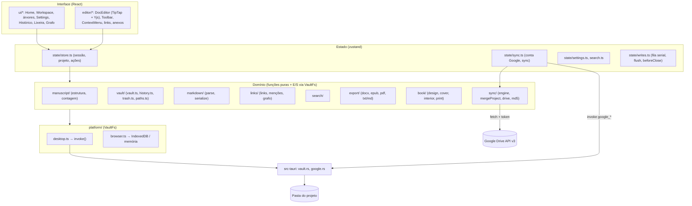
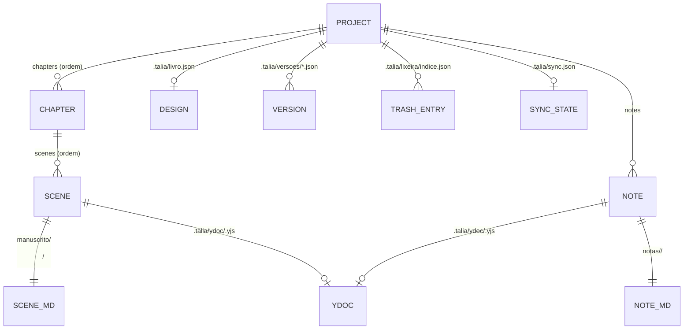
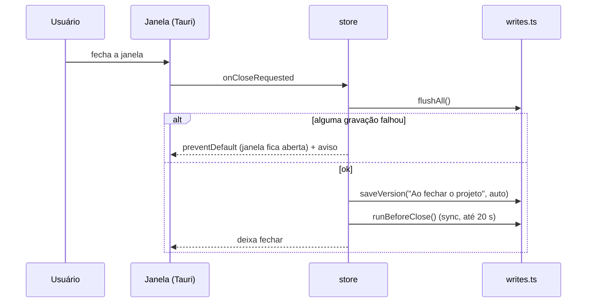
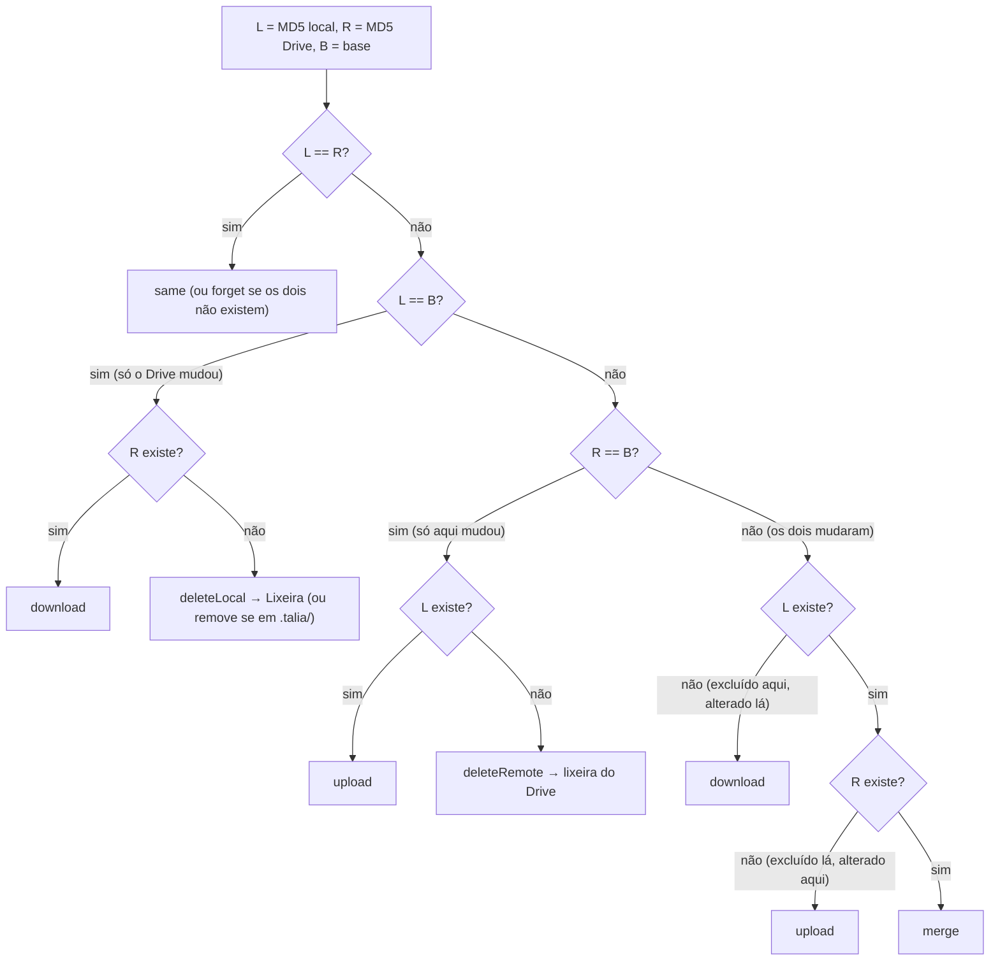
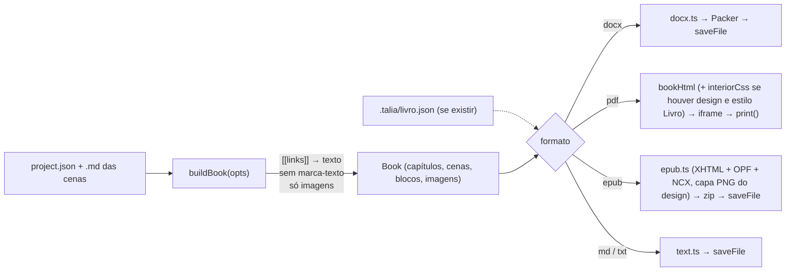

# Arquitetura da Tália

Documento técnico para quem vai manter ou estender o app. Descreve o código como ele está; quando
algo é uma limitação conhecida, isso é dito. O formato exato dos arquivos em disco está em
[Formato do projeto](formato-do-projeto.md).

## Sumário

1. [Visão geral](#1-visão-geral)
2. [Mapa de pastas e módulos](#2-mapa-de-pastas-e-módulos)
3. [Modelo de dados](#3-modelo-de-dados)
4. [Abstração de plataforma (`VaultFs`)](#4-abstração-de-plataforma-vaultfs)
5. [Fila de gravação e flush](#5-fila-de-gravação-e-flush)
6. [Editor: carregar, salvar e mudanças externas](#6-editor-carregar-salvar-e-mudanças-externas)
7. [Links, menções e grafo](#7-links-menções-e-grafo)
8. [Busca](#8-busca)
9. [Histórico de versões](#9-histórico-de-versões)
10. [Lixeira](#10-lixeira)
11. [Sincronização com o Google Drive](#11-sincronização-com-o-google-drive)
12. [Exportação](#12-exportação)
13. [Projeto gráfico (Diagramação)](#13-projeto-gráfico-diagramação)
14. [Comandos Rust](#14-comandos-rust)
15. [Gerar o instalador e publicar](#15-gerar-o-instalador-e-publicar)
16. [Segurança](#16-segurança)
17. [Testes e CI](#17-testes-e-ci)
18. [Estado do app (zustand) e armazenamento local](#18-estado-do-app-zustand-e-armazenamento-local)
19. [Limitações conhecidas](#19-limitações-conhecidas)

---

## 1. Visão geral

| Camada        | Tecnologia                                                                                 |
| ------------- | ------------------------------------------------------------------------------------------ |
| Casca desktop | **Tauri 2** (Rust), janela WebView2 (Windows) / WKWebView (Mac) / WebKitGTK (Linux)        |
| Interface     | **React 19** + **TypeScript** (Vite 6), estado em **zustand**                              |
| Editor        | **TipTap 3** (ProseMirror) com `@tiptap/extension-collaboration` sobre **Yjs**             |
| Grafo         | `d3-force` desenhando num `<canvas>`                                                       |
| Exportação    | `docx` (Word), `fflate` (zip do EPUB), impressão do WebView (PDF)                          |
| Rust          | `tauri-plugin-dialog`, `tauri-plugin-opener`, `reqwest` (rustls), `sha2`, `base64`, `rand` |

Princípios que atravessam o código:

- **O `.md` é a fonte da verdade para o usuário**; o `.yjs` é o estado do editor, usado para
  mesclar edições na sincronização.
- **A interface nunca toca em arquivos diretamente**: tudo passa por `VaultFs`.
- **Toda escrita é serializada** numa fila única (`serial`), para nenhuma gravação cruzar com um
  `rename`.
- **Nada é apagado**: excluir move para `.talia/lixeira/`.
- A ordem de capítulos e cenas fica em `project.json`, não no nome dos arquivos (reordenar não
  renomeia arquivos — bom para o sync).



---

## 2. Mapa de pastas e módulos

```
app/
  index.html              Página única (lang pt-BR), monta src/main.tsx
  vite.config.ts          Porta 1420; modo "preview" gera um HTML único (vite-plugin-singlefile)
  package.json            Scripts: dev, build, build:preview, typecheck, test, lint, format, tauri
  scripts/
    setup-windows.ps1     Instala Git, Node LTS, Rust, Build Tools C++, WebView2, pnpm (winget)
  src/
    main.tsx              createRoot + StrictMode, importa fontes e app.css
    App.tsx               Toast global (info some em 5 s; erro fica) e Home × Workspace
    platform/
      types.ts            Interfaces VaultFs, Platform, VaultRef, ChosenFolder, PlatformError
      index.ts            createPlatform(): desktop se "__TAURI_INTERNALS__" existe, senão navegador
      desktop.ts          TauriFs (invoke dos comandos Rust), diálogos, recentes no localStorage
      browser.ts          Projetos no IndexedDB (ou memória), download no lugar de "Salvar como"
      kvFs.ts             KeyValueFs: sistema de arquivos simulado sobre chave-valor; MemoryStore
      idbStore.ts         KeyValueStore sobre IndexedDB ("talia" / "files")
    vault/
      paths.ts            Constantes de caminho, slugify, uniqueName, folderName
      vault.ts            createVault, loadProject, saveProject, applyOps, loadSceneDoc, saveScene,
                          readProjectTexts, renameLinksInFiles, ExternalChangeError
      history.ts          Versões: saveVersion, listVersions, compareVersion, restoreProjectFiles
      trash.ts            moveToTrash, saveToTrash, listTrash, restorePlan, deleteFromTrash
      sample.ts           Projeto de exemplo da prévia no navegador
    manuscript/
      types.ts            Project, Chapter, Scene, Note, DocRef, TrashItem, FsOp, TreeChange
      tree.ts             Operações puras (add/rename/move/remove de capítulos, cenas, notas)
      wordCount.ts        countWords ("guarda-chuva" = 1), formatCount (pt-BR)
    markdown/
      parse.ts            Markdown → JSON do ProseMirror (subconjunto), splitFrontmatter
      serialize.ts        JSON do ProseMirror → Markdown; toPlainText
      types.ts            PMNode
    editor/
      extensions.ts       StarterKit (sem link, underline, code, codeBlock, undoRedo) + Highlight
                          + Attachment; textSchema; YDOC_FIELD = "default"
      DocEditor.tsx       Carrega cena/nota, cria o editor, salva com debounce, detecta mudança externa
      Toolbar.tsx         Barra de ferramentas
      ContextMenu.tsx     Menu do botão direito com seleção
      formatting.ts       Marcas, estilos de bloco e atalhos compartilhados
      links.ts            Plugin de decoração [[links]]/menções, Ctrl+clique, sugestões "[["
      attachments.ts      Nó "attachment", importação para anexos/, URLs blob:
      searchHighlight.ts  Decorações das ocorrências da busca
    links/
      links.ts            findWikiLinks, titleIndex, mentionMatcher, buildGraph, egoGraph,
                          renameLinksInText, linkEdits
      context.ts          KIND_LABEL, suggestLinks, createLinkContext (ponte editor ↔ store)
    search/search.ts      fold (sem acento/maiúscula, mesmo tamanho), findAll, snippet, searchProject
    sync/
      engine.ts           decide (três vias), hashLocal, planSync, applySync, sync.json
      mergeProject.ts     Junção de project.json por id
      drive.ts            Interface Drive e GoogleDrive (REST v3 com fetch)
      md5.ts              MD5 (RFC 1321) em TypeScript
    export/
      book.ts             ExportOptions, buildBook (limpa links, marca-texto, anexos), fileName
      html.ts             (X)HTML do livro e CSS (PDF e EPUB)
      pdf.ts              bookHtml + impressão num iframe escondido
      docx.ts             Word com a biblioteca docx (sumário como campo TOC)
      epub.ts             EPUB 3 + toc.ncx, zip com fflate
      text.ts             Markdown/texto num arquivo só
      index.ts            exportBook: escolhe o formato, usa livro.json se existir
    book/
      design.ts           BookDesign (livro.json), tamanhos, papéis, estimatePages, spineWidth,
                          coverSpread, BLEED
      cover.ts            Desenho da capa em canvas: renderPart, renderSpread, toPng
      interior.ts         CSS de impressão do miolo (@page :left/:right, capitular, cabeço)
      print.ts            Imprime uma imagem no tamanho exato (capa aberta)
    state/
      store.ts            useApp: plataforma, recentes, sessão, ações de projeto/versão/lixeira
      sync.ts             useSync: credenciais, conta, ligar/desligar, syncNow, download
      writes.ts           serial, registerFlush/flushAll, registerBeforeClose/runBeforeClose
      settings.ts         useSettings: tema, minimapa, seções recolhidas, intervalo de sync
      search.ts           useSearch: estado do painel de busca
      openEditors.ts      Editores abertos (troca de links ao renomear) e editor ativo
      comments.ts         useComments: comentários da cena aberta, painel e destaque
    ui/                   Telas: Home, Workspace (trilho + painel do Manuscrito), VaultSwitcher,
                          ManuscriptTree, WorldView (Mundo), GalleryView (Anexos), SearchPanel,
                          GraphView, graphCanvas, MiniMap, Settings,
                          HistoryView, TrashView, ExportView, BookDesignView, Book3D, DocPreview,
                          InlineEdit, Icon
    styles/               app.css (tema claro/escuro por CSS variables), fonts.css (@fontsource)
  src-tauri/
    tauri.conf.json       Janela, CSP, bundle (ícones, targets "all")
    capabilities/default.json   Permissões da janela: core:default, window destroy, dialog open/save
    Cargo.toml            Crate "talia" (lib talia_lib)
    src/main.rs           Esconde o console no Windows (release) e chama talia_lib::run
    src/lib.rs            Registra plugins e comandos
    src/vault.rs          Comandos de arquivo (com testes)
    src/google.rs         Login OAuth (loopback + PKCE), refresh e revoke (com testes)
.github/workflows/app.yml CI: verificações + instalador do Windows
site/index.html           Landing page estática (sem build)
```

---

## 3. Modelo de dados



- **`Project`** (`.talia/project.json`): `format: 1`, `id` (`prj_…`), `title`, `createdAt`,
  `updatedAt`, `chapters[]`, `notes[]`, `author?`.
- **`Chapter`**: `id` (`ch_…`), `title`, `dir` (pasta em `manuscrito/`), `scenes[]`.
- **`Scene`**: `id` (`sc_…`), `title`, `file` (`.md` dentro da pasta do capítulo).
- **`Note`**: `id` (`nt_…`), `title`, `kind` (`personagens` | `lugares` | `ideias` | `calendarios` | `idiomas` | `organizacoes`; ícones em `DOC_ICON`), `file`.
- Ids: prefixo + 12 hex de um UUID (`newId` em `manuscript/tree.ts`).
- Nomes de arquivo/pasta: `slugify(título)` (sem acentos, minúsculas, `-`, até 60 caracteres) +
  sufixo `-2`, `-3`… se já usado (`uniqueName`). A pasta do projeto usa `folderName` (mantém
  acentos e espaços, tira o que Windows/macOS/Linux recusam; nomes reservados viram "Meu livro").
- Ao abrir (e ao receber do Drive), `validateProject` confere a estrutura: listas no lugar, ids e
  títulos como texto, `dir`/`file` sem `/`, `\`, `:`, `..` ou caracteres de controle, `file`
  terminando em `.md`, `kind` conhecido. Um problema vira
  `VaultError("O arquivo .talia/project.json tem um problema (capítulo).")` (ou `estrutura`,
  `título`, `cena`, `nota`).

Toda mudança de estrutura é uma **função pura** em `manuscript/tree.ts` que devolve
`TreeChange = { project, ops: FsOp[] }`. `FsOp` é `move` (renomear arquivo/pasta) ou `trash`
(mandar para a lixeira, levando junto os `.yjs`). `useApp.change(edit, after?)` aplica, dentro da
fila serial: `applyOps` → `ensureChapterDirs` (cria `.keep` em capítulos vazios) →
`saveProject` → atualiza a sessão → `after(project)`.

Renomear cena/nota (`renameDocAndLinks`) também reescreve o cabeçalho do `.md`
(`rewriteSceneHeader`) e troca `[[Antigo]]` por `[[Novo]]`: nos editores abertos como uma edição
normal (`openEditors.ts`), nos demais direto no `.md` (`renameLinksInFiles`; o `.yjs` desses não
é tocado e a diferença é aplicada ao abrir).

---

## 4. Abstração de plataforma (`VaultFs`)

`src/platform/types.ts`:

```ts
interface VaultFs {
  readText(path): Promise<string | null>; // null = não existe
  writeText(path, data): Promise<void>;
  readBytes(path): Promise<Uint8Array | null>;
  writeBytes(path, data): Promise<void>;
  exists(path): Promise<boolean>; // arquivo ou pasta
  walk(): Promise<{ path; size; mtime: number | null }[]>; // todos os arquivos
  list(dir): Promise<string[]>; // só arquivos, direto na pasta; [] se não existe
  rename(from, to): Promise<void>; // cria as pastas de destino
  remove(path): Promise<void>; // arquivo ou pasta inteira
}
```

Caminhos são sempre relativos à raiz do projeto e usam `/`.

`Platform` acrescenta: `kind`, `chooseNewVaultRoot(nome)`, `chooseFolder?()` (só desktop),
`knownVaults()`, `rememberVault()`, `forgetVault()`, `fs(root)`, `saveFile(nome, bytes, filtro)`,
`openFile(root, path)` e `onClose?(beforeClose)` (só desktop).

| Aspecto           | Desktop (`desktop.ts`)                                 | Navegador (`browser.ts`)                                                                                          |
| ----------------- | ------------------------------------------------------ | ----------------------------------------------------------------------------------------------------------------- |
| Raiz              | Caminho absoluto da pasta                              | `browser:<uuid>`                                                                                                  |
| Arquivos          | Comandos Rust (`invoke`)                               | `KeyValueFs` sobre IndexedDB (chave `raiz + "\0" + caminho`); memória se o IndexedDB falhar (`persistent: false`) |
| Pastas            | Reais                                                  | Implícitas (existem enquanto há arquivos dentro)                                                                  |
| `mtime` no `walk` | ms desde 1970                                          | `null` (o MD5 é recalculado sempre)                                                                               |
| Recentes          | `localStorage["talia.recentVaults"]` (até 12)          | Derivados das chaves `…\0.talia/project.json`                                                                     |
| `forgetVault`     | Só tira da lista                                       | **Apaga os arquivos** do projeto                                                                                  |
| `saveFile`        | Diálogo "Salvar como" + `export_write`                 | Download (`<a download>`)                                                                                         |
| `openFile`        | `vault_open` (programa padrão)                         | Download                                                                                                          |
| `onClose`         | `onCloseRequested`; `preventDefault` se o flush falhar | Não existe (o editor grava em `visibilitychange`/`beforeunload`)                                                  |
| Sincronização     | Disponível                                             | Desligada (`useSync.available = false`)                                                                           |

Gravação segura: no desktop, `write_atomic` grava num temporário novo
`.<nome>.<aleatório>.talia-tmp` na mesma pasta, faz `sync_all` e renomeia por cima. O `walk` e
o sync ignoram `*.talia-tmp`.

---

## 5. Fila de gravação e flush

`src/state/writes.ts` define três mecanismos:

1. **`serial(task)`** — uma fila de promessas: cada tarefa começa depois da anterior terminar
   (com sucesso ou erro). **Toda** E/S que escreve passa por ela: gravação de cena, `change()`,
   versões, lixeira, `livro.json`, `sync.json` e o `applySync` inteiro. Leituras que precisam de
   um estado consistente também (carregar cena, listar versões, ler a lixeira).
2. **`registerFlush(fn)` / `flushAll()`** — gravações pendentes (o editor espera 700 ms de pausa
   na digitação). `flushAll` chama todos os flushers e depois espera a fila esvaziar; devolve
   `false` se algum falhou.
3. **`registerBeforeClose(fn)` / `runBeforeClose(20 s)`** — tarefas antes de fechar o projeto ou
   o app (hoje: sincronizar com o Drive). Rodam em paralelo com limite de 20 s para o app nunca
   ficar preso.

Fluxo de fechamento:



Sair do projeto pela interface (`closeVault`, `switchVault` e `openExistingFolder`, tanto para
outro projeto quanto para uma pasta comum) passa por `leaveSession`: `flushPending` →
`saveVersion("Ao fechar o projeto", auto)` → `runBeforeClose` → troca. Se a gravação falhar, o
projeto continua aberto. Escolher a pasta do próprio projeto aberto não faz nada.

Renomear o projeto (`renameProject` no store) muda o título com `change` e, no desktop, renomeia
a pasta só se o nome dela era `folderName(título antigo)`: `closeEditor` (grava e fecha o texto) →
`runBeforeClose` (sincroniza) → `serial(renameVaultFolder)` (comando `vault_rename_root`) → tira a
raiz antiga dos recentes → `open(raiz nova)` sem versão de abertura → devolve o texto e a tela
que estavam abertos. Se o Rust recusar (pasta em uso, nome já existe), o título fica mudado, a
pasta não, e o app mostra o motivo.

---

## 6. Editor: carregar, salvar e mudanças externas

`DocEditor` (uma instância por texto, `key={id}`) carrega via `serial(loadSceneDoc)`:

- se existe `.talia/ydoc/<id>.yjs`: aplica o update num `Y.Doc`, converte para Markdown e
  compara com o `.md` (`sameText`: só o corpo, sem o cabeçalho, com `trim`). Se diferem, o `.md`
  foi editado fora: `external = parseMarkdown(md)`, que o editor aplica com `setContent` **como
  uma edição** (preserva o histórico Yjs e desfazer);
- se não existe: cria o `Y.Doc` a partir do `.md` (`prosemirrorJSONToYDoc`).

O editor usa `Collaboration` (campo `YDOC_FIELD = "default"`), então o desfazer é o do Yjs.

```mermaid
sequenceDiagram
  participant E as Editor (Y.Doc)
  participant D as DocEditor
  participant Q as serial
  participant V as vault.saveScene
  participant FS as VaultFs
  E->>D: doc.on("update")
  D->>D: dirty = true; "Salvando…"; debounce 700 ms
  D->>Q: save()
  Q->>V: saveScene(doc, expected = diskText)
  V->>FS: readText(.md)
  alt .md mudou por fora (≠ expected)
    V-->>D: ExternalChangeError(diskText)
    D->>D: keepExternalCopy → nova cena "(versão externa)"
    D->>Q: save(retry=false) com expected = texto de fora
  else igual (ou arquivo apagado)
    V->>FS: writeBytes(.yjs)
    V->>FS: writeText(.md com frontmatter)
    V-->>D: written → diskText
  end
```

Gatilhos de gravação: debounce de 700 ms, `visibilitychange` para `hidden`, `beforeunload`,
desmontagem do editor e `flushAll`. Ao **voltar** para a janela (`focus` / `visible`),
`checkDisk` relê o `.md`: se mudou e não há edição pendente, aplica o texto novo como edição; se
há edição pendente, salva (o que dispara o conflito acima).

Detalhes:

- `liveDocs` conta quantas instâncias usam o `Y.Doc`, porque o `StrictMode` monta e desmonta de
  novo; o doc só é destruído quando ninguém mais usa, dentro da fila.
- O texto puro do editor alimenta `session.texts`/`words` (`setDocText`), usados pela contagem,
  pelo grafo e pela busca.
- Arquivos soltos/colados viram anexos (`handleDrop`/`handlePaste` → `addAttachments` →
  `insertAttachments`).
- O nó `attachment` é atômico; no `.md` vira `` numa linha própria
  (entre `< >` se o caminho tiver espaço ou parênteses). Os arquivos são lidos como `blob:` com
  cache por caminho (`attachmentUrl`).

Subconjunto de Markdown (`markdown/serialize.ts` e `parse.ts`): parágrafos, títulos 1–3 (o parser
aceita até 6), citação, listas com marcador e numeradas (com `start`), `* * *` (separador),
quebra de linha (`\` no fim da linha), `**negrito**`, `*itálico*`, `~~tachado~~`, `==destaque==`
e anexos. Colchetes não são escapados, para os `[[links]]` continuarem legíveis. Listas dentro de
itens de lista são lidas e gravadas coladas. O alinhamento (`editor/textAlign.ts`, atributo
`textAlign` de parágrafo/título) vira `<!-- alinhar: … -->` antes do bloco e é respeitado na
prévia e nas exportações (HTML/EPUB e DOCX).

### 6.0 Linha do tempo

`timeline/timeline.ts`: `readTimeline`/`writeTimeline`/`sanitizeTimeline` (formato em
`formato-do-projeto.md`) e `buildTimeline` (pura: agrupa por dia, calcula o intervalo desde o fim
do grupo anterior, lista as cenas sem data e marca as "fora de ordem" em relação ao livro).
Estado em `state/timeline.ts` (gravação pela fila `serial`); tela em `ui/TimelineView.tsx`,
dentro da aba Calendários do Mundo (sub-seção "Linha do tempo"). `timeline/calendar.ts` converte
dia da história ↔ data do calendário do mundo (`dayToDate`, `dateToDay`, `formatDate`,
`holidaysOn`, `seasonOf`); a definição é editada em `ui/CalendarEditor.tsx` (ficha de uma nota de
calendário). Continuidade: `continuity()` (pura) calcula as idades (`ageOn`, anos do calendário
ativo ou 365), o local de cada cena (escolhido ou o único lugar ligado) e os avisos de viagem,
só quando a chegada é mais cedo que `travelDays`; nunca adivinha distâncias nem reclama de
viagens lentas. Nascimento e tempos de viagem são editados em `ui/ContinuityEditors.tsx` (fichas
de personagem e lugar). Faixas: `buildLanes()` (uma linha por nota, uma coluna por dia ocupado).
Calendário de escrita: `writing/writing.ts` (`streak`, `lastDays`, `heatmap`) e
`state/writing.ts`; o `DocEditor` soma ao dia as palavras novas de cenas (diferença positiva a
cada pausa) e grava com folga de 5 s (e no `flushAll`). Datas fictícias de teste em
`timeline/example.ts` (também usadas em `vault/sample.ts`).

### 6.1 Comentários

- Dados em `.talia/comentarios/<id>.json` (`comments/comments.ts`: `readComments`,
  `writeComments`, `sanitizeComments`; formato em `formato-do-projeto.md`). Gravação pela fila
  (`serial`) a partir de `state/comments.ts`.
- Âncora: `editor/commentAnchors.ts` converte a seleção em duas `Y.RelativePosition`
  (`absolutePositionToRelativePosition` com o `binding` do `ySyncPluginKey`) e, para desenhar,
  volta para posições absolutas (`relativePositionToAbsolutePosition`).
- Os destaques são decorações (`CommentAnchors`). Em edição local elas só são **mapeadas** pela
  transação (o mapeamento do Yjs ainda não foi atualizado ali); são recalculadas pelas âncoras
  quando chega uma transação do `ySyncPluginKey` (abrir, desfazer, Yjs) ou `REFRESH_COMMENTS`.
- UI em `editor/Comments.tsx` (`CommentComposer`, `CommentsPanel`); atalho Ctrl/⌘+Alt+M.
- Campos da ficha: `manuscript/fields.ts` (`NOTE_FIELDS` por tipo, com `section` abrindo seções,
  `hint`, tipo `choice` com `options` e `legacy` para campos antigos que só aparecem preenchidos —
  `visibleFields` aplica isso —, `sanitizeFields`,
  `mergeFields` campo a campo no `mergeProject`, `fieldRefs`); gravados em `notes[].fields` por
  `setNoteFields` (pela `change`); campos de referência viram arestas "link" em `buildGraph`. A tela
  é `ui/NoteFields.tsx` (na ficha e, compacta, na edição rápida), com seções em cartões, o índice
  `FieldSectionNav` e o `CharacterPanel` (sugestões de `manuscript/characterCheck.ts`); listas de
  escolha usam `ui/Select.tsx` (combobox próprio, com teclado) no lugar do `<select>` nativo.
- Mapa da região e brasão (`ui/PlaceRegion.tsx`): `world/village.ts` gera o mapa de forma
  determinística a partir das opções gravadas em `fields.mapa` (semente mulberry32 em
  `world/geom.ts`; estrada e ruas por caminhada aleatória suavizada, casas ao longo das ruas com
  teste de sobreposição SAT, campos e árvores); `ui/PlaceMap.tsx` desenha em SVG (zoom/arrastar
  por `viewBox`); `ui/StreetView.tsx` é um renderizador 3D em canvas 2D (casas como caixas com
  telhado de quatro águas, projeção em perspectiva, recorte no plano próximo, descarte de faces
  de costas e pintura de trás para frente, com neblina; `walkable` impede entrar nas casas).
  `world/heraldry.ts` gera brasão/bandeira de `fields.brasao`, desenhados por `ui/EmblemArt.tsx`.
- Mapa-múndi (`ui/WorldMapView.tsx`, view `"map"`): `world/worldgen.ts` gera e deriva o mundo numa
  grade de 360×180 células (o planeta inteiro, equirretangular, 1° por célula; a longitude dá a volta: vizinhos usam `wrapCol`, distâncias `dCol`, o relevo usa ruído 3D (Perlin) amostrado sobre a esfera e distância pelo arco até os centros dos continentes — sem emenda e sem distorção nos polos —, os caminhos medem passos com `stepLen` (largura da célula × cos(latitude)), e o oceano é o maior corpo d'água). Gravado: alturas (base64), cidades e estados em `.talia/mapa-mundi.json`
  (`state/worldMap.ts`, via `serial()` com espera de 600 ms e `registerFlush`; `load` não relê o
  disco se o projeto já está carregado, para não perder edições pendentes). Derivado em
  `deriveWorld` (~100 ms): distância à costa (BFS), temperatura e umidade (ruído fractal +
  latitude/altitude/costa), priority-flood para tirar depressões, vazão e rios, biomas
  (Whittaker simplificado), estados por Dijkstra multi-fonte a partir das capitais (custo por
  bioma, subida e rios) e estradas pelos predecessores desse Dijkstra (cidade → capital e entre
  capitais vizinhas). `world/worldRender.ts` assa a imagem de fundo (biomas/relevo/político com
  sombreamento) e monta caminhos vetoriais (costa e fronteiras por marching squares, rios e
  estradas suavizados); o canvas desenha isso com zoom/arraste e os rótulos em pixels de tela, sem
  sobreposição.
- Clima, culturas e nomes (ideias estudadas no Fantasy Map Generator, de código aberto, e
  reimplementadas aqui): `climate()` em `world/worldgen.ts` calcula a temperatura em °C (trópicos,
  queda até os polos, −6,5 °C/km) e a chuva por ventos predominantes em faixas de 30° (umidade
  ganha sobre o mar, perdida sobre a terra, extra nas subidas, ar seco depois de serras altas),
  suavizada e normalizada; `biomeFor` escolhe o bioma por temperatura × umidade. `placeCultures`
  põe os centros dos povos (tipo pelo lugar, base de nomes pelo clima) e `deriveWorld` expande cada
  cultura com custos por tipo (`d.culture`). `world/names.ts` gera nomes por cadeia de Markov de
  ordem 2 sobre bases de nomes próprias do app. Reinos têm `form`; elementos da cidade seguem
  regras de população (`world/settlement.ts`).
- Épocas (`options.era`: `fantasia` ou `atual`, "Real" na tela): `withEra` converte as formas de
  governo por arquétipo (`formForEra`); `deriveWorld` põe `d.era`, aquece o clima (+1,2 °C, mais
  nos polos), cria os biomas 14 (Área urbana) e 15 (Lavouras) em volta das cidades e nomeia as
  estradas; `deriveSociety` troca os marcadores (`ERA_MARKERS`) e põe aeroporto/universidade nas
  capitais; `settlementInfo` multiplica a população; `ruralPopulation` dá a população do campo;
  `bakeBase` e o `Theme` de `ui/worldDraw.ts` fazem o estilo de atlas; `localGeo` passa a época à
  vila (`floorsFor`, cores em `PlaceMap`, laje em `StreetView`).
- Clima configurável (`map.climate`, `ui/ClimateDialog.tsx`): `normalizeClimate` limita os valores;
  `seaLevelTemp` interpola entre o polo do hemisfério e o equador com `(lat/90)^1,6`; em
  `climate()` cada faixa de 30° usa o componente leste-oeste do vento escolhido (quase norte-sul:
  umidade dos dois lados, pela metade) e `precipitation` multiplica a umidade normalizada. Entra no
  `geoKey` do editor e nos passos de desfazer.
- Hidrologia (`deriveWorld`): priority-flood dá o nível da água (`filled`); a direção `down` é o
  maior declive sobre `filled` (sempre desce, então não há ciclos). Componentes de depressão
  (`filled − h ≥ 0,3`, ≥ 2 células, profundidade ≥ 1, sem cidade dentro) viram lagos (`d.lakes`,
  `d.lake`; `land = 0`, e `d.eff` são as alturas para desenhar, com o lago abaixo do nível do
  mar). A vazão acumula o escoamento `chuva − evaporação(temperatura)`; um lago cuja entrada é
  menor que a evaporação da superfície fica salgado e a saída é bloqueada (a vazão é recalculada).
  Rios guardam `source` (margem do lago de origem) e `mouth` (margem do mar/lago);
  `worldRender.riverPieces` desenha trechos que engrossam com √vazão e meandros nas planícies.
- Províncias, religiões e marcadores (`world/society.ts`, `deriveSociety`): derivados (não
  gravados). Províncias: sedes = capital + cidades mais afastadas (área/260), Dijkstra restrito ao
  estado. Religiões: folclórica por cultura, organizadas a partir de capitais (Dijkstra com custo
  menor dentro do estado de origem), cultos locais. Marcadores por regras de terreno (picos,
  degraus de rio, serras, estradas, costa, fronteiras) com nomes Markov da cultura local.
  `buildProvinceVectors` faz as divisas (marching squares dentro do mesmo estado); o modo
  `religioes` de `bakeBase` recebe a religião de cada célula.
- Prévia da cidade (`world/village.ts`, `generateFromGeo`): com `geo` (de `localGeo` em
  `world/settlement.ts`: direção da água num raio de 3 células, do rio pelo `down` e das estradas
  geradas que passam pela cidade, e o visual do bioma), a vila tem mar/lago, rio e estradas nas
  direções reais. A geografia usa uma semente fixa da cidade e casas/ruas/lavouras a semente das
  opções; `geo` não é gravada (`serializeMapOptions`). Cidades do mapa são escolhidas por
  habitabilidade do bioma, clima, declive, rios (mais em confluências) e costa, com metade das
  vagas reservadas ao interior.
- Mapa ↔ Mundo (`world/worldNotes.ts`, chamado por `useWorldMap.reconcile`): cada estado e cidade
  tem um lugar (`noteId`). `syncWorldNotes` liga/cria os lugares (aproveitando título igual), puxa
  os nomes das fichas e tira do mapa o que foi apagado no Mundo (ou recria, ao desfazer);
  `applyWorldFields` preenche `tipo` e `regiao` só onde estão vazios ou foram postos pelo mapa;
  `retireNotes` manda para a lixeira os lugares que saíram do mapa e nunca foram mexidos. A
  reconciliação roda depois de cada mudança no mapa e quando as notas do projeto mudam (com o mapa
  aberto), dentro de `change` (fila única).
- "Editar povoado" (`ui/BurgDialog.tsx`): janela flutuante do mapa-múndi. `world/settlement.ts`
  junta os campos do lugar com valores padrão tirados do mapa (população pela semente, porto/rio
  pela costa e vazão, temperatura e altitude da célula) e monta as opções da prévia, que é o
  mesmo gerador de vila (`world/village.ts`, agora com muralha, cidadela, praça, templo e favela,
  e com o centro sempre no meio do mapa).
- Desenho do mapa-múndi em `ui/worldDraw.ts` (`drawWorld`, usado na tela e no "Exportar
  imagem"). O editor só refaz `deriveWorld` quando muda a geografia (alturas, posições das
  cidades, capitais); renomear ou mudar cor não refaz. Enquanto o pincel pinta, a imagem de fundo
  é assada em 1 px por célula e só a costa é recalculada (`coastPath`); o resto espera soltar.
  Cidades arrastadas só movem o marcador até soltar.
- Planeta e globo: na tela, o mapa plano é um planeta só (`single`: recortado nas bordas; as cópias
  vizinhas só completam o que cruza a costura) e a vista é limitada por `clampView` (zoom mínimo = 100%,
  o planeta inteiro; centraliza no eixo que sobra, onde `drawWorld` mostra o que fica além do
  polo (a imagem espelhada e deslocada 180° na longitude); sem passar das bordas); `drawWorld` sem `single` repete na horizontal. As
  linhas que cruzam a costura são "desembrulhadas" (`unwrap`). `ui/GlobeView.tsx` desenha o globo
  em projeção ortográfica: o mapa plano vira textura (`drawWorld` sem nomes nem cidades) e cada
  pixel do disco é convertido em latitude/longitude para buscar a cor, com luz e atmosfera; nomes,
  cidades e linhas de latitude/longitude são projetados por cima (só o lado visível). Ao girar,
  desenha em resolução menor.
- Estradas geradas (`deriveWorld`): busca A* em 16 direções com arrays reaproveitados (carimbo por
  busca), custo de engenharia por passo (`roadStep`: rampa ao quadrado, altitude, bioma, aspereza
  fixa por célula, desconto em vales ao lado de rios e em estradas existentes, custo de ponte ao
  entrar num rio, proporcional à vazão). Rodovias ligam capitais de estados vizinhos; estradas
  vão de cada cidade até a capital (ou até a rodovia); trilhas ao vizinho mais perto. Cada estrada
  tem nome; `bridges` guarda posição e direção das pontes. `cellsPath` suaviza os traçados
  (Chaikin). O relevo é girado para a borda de 180° cair no meridiano com menos terra, e a faixa da
  borda e as latitudes acima de ~58° viram mar no fim da geração.
- Globo: `ui/GlobeView.tsx` usa WebGL (shader de esfera ortográfica sobre a textura do mapa plano,
  luz, atmosfera e estrelas na GPU; nomes e cidades numa camada 2D por cima; giro em refs, um
  desenho por quadro). Sem WebGL, cai em `ui/GlobeCpu.tsx`, onde a tabela por pixel (linha da textura, longitude sem giro, luz, borda) fica em cache e só é
  refeita quando muda tamanho, zoom ou inclinação; girar para os lados só desloca a longitude; ao
  arrastar, desenha em meia resolução; o efeito de desenho tem dependências explícitas (o mouse
  parado sobre o globo não redesenha).
- Rotas: `deriveWorld` classifica as estradas geradas (`principal` entre capitais vizinhas,
  `estrada` cidade → capital cortada onde encontra a rodovia, `trilha` por Dijkstra limitado até a
  cidade mais perto, só se o caminho for majoritariamente novo) e calcula o caminho das rotas
  desenhadas (`map.routes`) entre os pontos de passagem pelo mesmo Dijkstra (marítimas ficam
  retas). `buildVectors` monta um `Path2D` por tipo e, por rota, o caminho, o comprimento e o ponto
  do meio para o nome.
- Menções/links: o cartão ao passar o mouse usa `LinkContext.describe()`; a edição rápida
  (`editor/NoteQuickEdit.tsx`) lê o corpo com `readDocBody` e grava o `.md` com
  `writeSceneMarkdown` pela fila; o `.yjs` da nota fica para trás e, ao abrir a nota, a diferença
  do `.md` é aplicada como edição (o mesmo caminho de uma mudança feita fora do app). A ficha
  aberta no Mundo vive em `state/worldNav.ts`, para o cartão poder pedir uma ficha.

---

## 7. Links, menções e grafo

`src/links/links.ts`:

- **Wikilinks:** `/\[\[([^[\]|\n]+?)(?:\|[^[\]\n]*)?\]\]/g` — `[[Nome]]` e `[[Nome|texto]]`.
- **Resolução** (`titleIndex` / `resolveLink`): título com `trim` e `toLocaleLowerCase("pt-BR")`.
  O comentário diz que notas têm prioridade, mas, como o índice é preenchido com
  `allDocs().reverse()` e o último `set` vence, **numa colisão de títulos a cena vence a nota**
  (verificado). As sugestões de `[[` (`suggestLinks`) mostram as notas primeiro.
- **Menções** (`mentionMatcher`): uma regex com os títulos das notas (≥ 2 caracteres, os mais
  longos primeiro), **sem diferenciar maiúsculas** (flag `i`; o título é achado em minúsculas
  `pt-BR`) e exigindo fronteira de palavra Unicode
  (sem lookbehind, por compatibilidade com macOS < 13.3).
- **Grafo** (`buildGraph`): um nó por cena/nota; arestas não direcionadas, deduplicadas; um link
  escrito prevalece sobre uma menção entre os mesmos dois textos. `degree` define o tamanho do
  ponto. `egoGraph` recorta o texto aberto e os vizinhos diretos (minimapa).
- **Renomear:** `renameLinksInText` e `linkEdits` trocam só o alvo, mantendo o alias.

No editor (`editor/links.ts`): um plugin ProseMirror recalcula decorações a cada mudança do doc
ou quando os títulos mudam (`REFRESH_LINKS`); `handleClick` com Ctrl/⌘ abre o alvo, ou cria uma
nota **do tipo `ideias`** quando o link não resolve; `@tiptap/suggestion` com `char: "[["` mostra
a lista. Os índices são cacheados por objeto `Project` (`WeakMap`).

`ui/graphCanvas.ts` (`mountGraph`) é compartilhado entre o grafo completo e o minimapa
(`compact`): simulação `d3-force` (link, charge, collide, x/y), arrastar nós (fixa `fx/fy`),
arrastar o fundo (pan), roda = zoom (0,2× a 4×), hover destaca vizinhos, clique sem arrastar abre.
Visual de grafo de notas: pontos lisos em `--muted` (raio pelo grau), linhas finas em `--edge`;
hover pinta o ponto e as ligações dele em `--accent` e esmaece o resto; o texto aberto ganha anel.
As posições e a visão são guardadas em `ref`s para o grafo não "pular" entre renderizações. O
minimapa só remonta quando os nós/arestas mudam de fato (`graphKey`) e espera 600 ms de pausa
na digitação.

---

## 8. Busca

`src/search/search.ts`:

- `fold(text)` tira acentos e passa para minúsculas **caractere a caractere sem mudar o
  tamanho** (se a forma "dobrada" tiver outro comprimento, mantém o original), para as posições
  continuarem valendo no texto original.
- `findAll(text, query, { exact, wholeWord })` — busca sequencial sem sobreposição; `wholeWord`
  testa `[\p{L}\p{N}_]` antes e depois.
- `searchProject` percorre `allDocs` (cenas na ordem do livro, depois notas) sobre
  `session.texts` (texto puro), e marca `inTitle`.
- `snippet` corta ±48 caracteres em fronteira de espaço.

O painel (`SearchPanel`) usa `useDeferredValue`. Ao clicar num trecho, `useSearch.goTo(id, i)`;
o `DocEditor` daquele texto recalcula as ocorrências no doc do ProseMirror
(`searchHighlight.ts`) e seleciona a de índice `i`.

---

## 9. Histórico de versões

`src/vault/history.ts`. Cada versão é `.talia/versoes/<id>.json` com a estrutura e o **corpo
Markdown (sem frontmatter)** de todas as cenas e notas, lidos do disco (`readBodies`). Anexos não
entram. Um índice `.talia/versoes/indice.json` (só metadados) acelera a lista; se faltar ou
estiver corrompido, é refeito a partir dos arquivos.

- `id = "v-" + ISO(createdAt)` com `:` e `.` trocados por `-` (com sufixo se colidir).
- `hash` = FNV-1a 32 bits de `JSON.stringify({ title, chapters, notes, texts })`. Uma versão
  **automática** igual à última não é gravada.
- Poda (`versionsToPrune`): mantém as 20 automáticas mais recentes; das mais antigas, mantém a
  mais recente de cada dia. Manuais nunca são podadas.
- Gatilhos automáticos: abrir projeto ("Ao abrir o projeto"), intervalo de 10 min no
  `Workspace` ("Automática"), `closeVault`/`switchVault` ("Ao fechar o projeto").
- `compareVersion` classifica cada texto em `changed | same | removed | added`.
- `restoreText` (store): salva antes uma versão manual "Antes de restaurar …", grava o corpo no
  `.md` (ou recria a cena/nota se foi excluída, no mesmo capítulo/posição ou num capítulo novo).
- `restoreProjectFiles`: manda `manuscrito/` e `notas/` para a lixeira como `backup`, reescreve
  todos os `.md` da versão e o `project.json`. O `.talia/ydoc` fica; cada texto aplica a
  diferença como edição ao abrir.

Na sincronização, os arquivos de versão são sincronizados, mas `indice.json` não: quando chega ou
sai uma versão, o índice local é apagado (`forgetVersionIndex`) e refeito na próxima leitura.

---

## 10. Lixeira

`src/vault/trash.ts`. Tudo em `.talia/lixeira/`, com um índice `indice.json`
(`TrashEntry[]`: `id`, `deletedAt`, `title`, `item`, `path`, `ydocs`).

- `moveToTrash(path, item, sceneIds)` move o arquivo/pasta para
  `.talia/lixeira/<stamp>-<nome>` e os `.yjs` das cenas para `<stamp>-<id>.yjs`.
- `saveToTrash(path, bytes, label)` grava um conteúdo que não existia em arquivo (cópias da
  sincronização) como item `backup`.
- `restorePlan` calcula o projeto novo e os `move` de volta: ids já usados ganham id novo; nomes
  ganham sufixo; cena sem capítulo volta num capítulo novo com o mesmo título; anexos voltam para
  `anexos/` com nome único. Para `backup` devolve `null`: quem restaura é `vault/backup.ts`.
- `vault/backup.ts`: `readBackup` lê a cópia (um arquivo ou uma pasta, usando `fs.walk()`) e
  separa textos `.md` (título e id do cabeçalho, capítulo ou tipo de nota pela pasta), anexos
  (extensões de `attachmentKind`) e arquivos técnicos. `backupRestorePlan` nunca substitui nada:
  texto de uma cena que existe (pelo id, senão pelo título) vira cena nova logo abaixo, de uma nota
  vira nota nova; pasta `manuscrito/` vira um capítulo "(recuperado)" por capítulo; pasta
  `notas/` devolve as notas; o resto vai para o capítulo "Recuperados da Lixeira"; anexos voltam
  com nome único. O `restoreBackup` do store aplica o plano com `change`, grava os textos com
  `writeSceneMarkdown` e tira a entrada da lixeira; se sobraram arquivos técnicos, a entrada fica
  só com eles.
- `emptyTrash` remove a pasta inteira (inclusive restos sem índice).

`TrashItem`: `scene` (com capítulo e índice de origem), `chapter` (com cenas e índice), `note`,
`attachment` (nome) e `backup` (rótulo). A Lixeira não é sincronizada.

---

## 11. Sincronização com o Google Drive

### 11.1 Conta e credenciais

`src/state/sync.ts` + `src-tauri/src/google.rs`.

- **Credenciais do app** (ID e segredo do cliente OAuth "App para computador"): vêm de
  `VITE_GOOGLE_CLIENT_ID`/`VITE_GOOGLE_CLIENT_SECRET` na compilação (`app/.env.local`, fora do
  Git) ou do formulário em Configurações (`localStorage["talia.googleClient"]`).
- **Login** (`google_sign_in`): abre `TcpListener` em `127.0.0.1:0` (porta aleatória), gera
  `state` (16 bytes) e verificador PKCE (48 bytes, desafio S256), abre o navegador em
  `accounts.google.com/o/oauth2/v2/auth` com `scope=drive.file`, `access_type=offline` e
  `prompt=consent`, espera até 5 min o redirecionamento com o `state` certo (ignora outros
  pedidos, como o favicon), responde uma página HTML e troca o `code` por tokens em
  `oauth2.googleapis.com/token`.
- O **refresh token** e o e-mail ficam em `localStorage["talia.google"]`. O access token fica
  só em memória e é renovado (`google_refresh`) quando falta menos de 1 min para vencer, ou
  quando o Drive responde 401.
- **Desconectar** apaga a conta local e chama `google_revoke`.

### 11.2 Pastas no Drive

`src/sync/drive.ts` (`GoogleDrive`, REST v3 via `fetch`):

- Pasta raiz `Tália` marcada com `appProperties.taliaRoot = "1"` (é a marcação que identifica a pasta,
  não o nome).
- Cada projeto: pasta com o título do projeto, marcada com
  `appProperties.taliaProject = <project.id>` (é o id que identifica, não o nome). As subpastas
  espelham o caminho dos arquivos. Quando o projeto muda de nome, `ensureFolderTitle` (no começo
  de cada sync do projeto aberto) chama `renameFolder` (`PATCH { name }`) e guarda o nome em
  `sync.json` (`folderTitle`).
- `list(folderId)` percorre a árvore (BFS) e devolve `caminho → { id, md5Checksum }`.
- Envio: até 5 MB em `multipart` (novo) ou `media` (substituir); acima, `resumable`.
- Remover = `PATCH { trashed: true }` (lixeira do Drive, 30 dias).
- Erros: 401 → renova o token uma vez; 429, 403 de limite de uso e 5xx → até 3 novas tentativas
  com espera de 0,5 s, 1 s, 2 s. Sem rede: `DriveError("Sem conexão com o Google Drive…")`.

### 11.3 Algoritmo (três vias por MD5)

`src/sync/engine.ts`. Estado em `.talia/sync.json` (`folderId`, `base`, `cache`,
`projectBase`, `lastSync`, `folderTitle`).

Ficam **fora** da sincronização: `.talia/sync.json`, `.talia/versoes/indice.json`,
`.talia/lixeira/**`, `*.talia-tmp`, `.DS_Store`, `Thumbs.db`, `desktop.ini`.

1. **`hashLocal`**: MD5 de cada arquivo local; reaproveita o `cache` quando `size` e `mtime`
   não mudaram (no navegador, `mtime = null`, recalcula sempre).
2. **`drive.list`**: MD5 de cada arquivo remoto.
3. **`decide(local, remote, base)`** para cada caminho:



4. **`planSync`** só lê. Calcula também `touchedDocs`: cenas/notas cujos arquivos vão ser
   escritos (qualquer ação que não seja `same/forget/upload/deleteRemote`; se `project.json` muda,
   todos). O `syncNow` fecha o editor do texto ativo se ele estiver em `touchedDocs` e reabre no
   fim.
5. **`applySync`** roda **inteiro dentro de `serial`** (as gravações do app esperam). Ordem:
   - todas as ações, exceto `project.json`. Como o plano foi feito antes de pausar as gravações,
     antes de um `download` ou `deleteLocal` o MD5 local é conferido de novo (`plan.local`): se o
     arquivo mudou nesse meio-tempo, o `download` vira `merge` e o `deleteLocal` vira `upload`;
   - antes de sobrescrever um `.yjs`, guarda o conteúdo anterior em memória (`previousYdoc`), para
     notar depois um `.md` editado fora do app;
   - `merge` de um `.yjs`: `Y.mergeUpdates([local, remoto])`, grava, envia e marca o texto para
     refazer o `.md`. **Rede de segurança:** para cada lado, se alguma **palavra** do texto
     daquele lado (minúsculas, letras e números) não aparece no texto mesclado, a versão inteira
     daquele lado vai para a lixeira (`saveToTrash`, rótulo "… versão deste computador/do Drive
     antes de mesclar (conferir)") e conta em `keptBoth`;
   - `merge` de um `.md` cujo `.yjs` também muda nesta rodada: ignora (o `.md` é refeito);
   - `merge` de outro arquivo: envia o local e guarda o remoto na lixeira ("… — versão do Drive
     (conflito)");
   - **`project.json` por último**. O do Drive é validado (`validateProject`); se estiver
     corrompido ou com nomes inseguros, fica o local, o do Drive vai para a lixeira
     ("project.json do Drive (com problema)") e o local é enviado. Senão, tanto no `merge` quanto
     no `download` ele é **juntado** com o local (`mergeProjects(projectBase, local, remoto,
changed)`), onde `changed` são os textos alterados de cada lado nesta rodada — assim uma
     cena excluída de um lado mas editada do outro não some;
   - `placeDocs`: para cada cena/nota do projeto final, refaz o `.md` (frontmatter + Markdown do
     `Y.Doc`) se o `.yjs` chegou ou foi mesclado. Se o `.md` daqui tinha sido editado fora do app
     (difere do `.yjs` anterior e do novo), guarda essa versão na lixeira ("… — editado fora do
     app antes de sincronizar"). Se a junção mudou o nome do arquivo de um texto, encontra o
     `.md` certo pelo `id` do cabeçalho e move o conteúdo. Envia o que mudou;
   - se algo mudou em `versoes/`, apaga o índice local de versões;
   - o novo `base` é o MD5 de tudo que ficou igual nos dois lados; o `cache` perde as entradas
     dos arquivos escritos (o `mtime` mudou).
6. `writeSyncState`, `reloadFromDisk` se algo chegou, e aviso ao usuário se `keptBoth > 0`.

### 11.4 Junção de `project.json`

`src/sync/mergeProject.ts`, por id:

- capítulos e notas: o que um lado criou entra; o que um lado excluiu (existia na base) sai;
  ordem do local, com os criados só no remoto inseridos na posição que têm lá;
- campos (`title`, `dir`, `file`, `kind`): `pick(base, local, remoto)` — vale o lado que mudou;
  se os dois mudaram, o local;
- cenas: posição (capítulo, índice) do remoto só se apenas o remoto moveu; senão a local. Cena
  num capítulo que não existe mais vai para o primeiro capítulo (ou para um capítulo novo
  "Recuperados", se não sobrou nenhum);
- **excluído de um lado e alterado do outro** (texto em `changed`): a cena ou nota fica;
- `title` do projeto por `pick`; `updatedAt = max`;
- no fim, `uniqueNames` garante nomes de pasta e de arquivo únicos (por exemplo, os dois
  computadores criaram "Cena 2" no mesmo capítulo: um vira `cena-2-2.md`).
- Sem `projectBase` (primeira sync de um projeto que já existia dos dois lados), a base é o
  local sem capítulos e notas — ou seja, tudo é tratado como "criado" e unido.

### 11.5 Quando sincroniza

- ao abrir o projeto (`attach` no mount do `Workspace`);
- a cada `syncEvery` minutos (preferência global: 0, 5, 15, 30; padrão 5);
- antes de fechar/trocar o projeto ou fechar a janela (`registerBeforeClose`, até 20 s);
- pelo botão "Sincronizar agora".

Uma sincronização de cada vez (`running`). Baixar um projeto (`download`) cria uma pasta nova
com `chooseNewVaultRoot`, roda o sync com `base = {}` (tudo vira `download`) e abre.

---

## 12. Exportação



- **`buildBook`**: só os capítulos marcados; conta palavras do texto original; `clean` remove a
  marca `highlight`, troca `[[Nome|alias]]` por `alias`/`Nome` (também quando o link está
  partido em vários nós de texto) e descarta anexos que não são imagem PNG/JPG/GIF/WebP/SVG (ou
  todos, se `images = false`).
- **Word** (`docx.ts`): estilo Livro em Georgia 11 pt, entrelinha 1,5, página 14×21/A5/A4;
  Manuscrito em Times New Roman 12, espaço duplo, A4, margens 25 mm e cabeçalho
  "Sobrenome / TÍTULO / página". Sumário = campo TOC com `updateFields: true` (o Word pergunta se
  atualiza). WebP e SVG são convertidos para PNG num `OffscreenCanvas`.
- **PDF** (`pdf.ts`): HTML com `@page` (tamanho, margens, número de página) num iframe invisível
  e `print()`. Com `livro.json` e estilo Livro, o CSS vem de `book/interior.ts`, entra a página de
  créditos e uma página em branco para o 1º capítulo cair na direita.
- **EPUB** (`epub.ts`): EPUB 3 com `nav` e `toc.ncx` (leitores antigos); `mimetype` primeiro e
  sem compressão; capa = `renderPart("front")` a 1600 px de largura se houver design.
- **Markdown/Texto** (`text.ts`): um arquivo; título/autor no topo se "Folha de rosto".
- Nome do arquivo: `folderName(título).<ext>`.
- As opções são guardadas por projeto em `localStorage["talia.export.<projectId>"]`
  (capítulos desmarcados ficam em `uncheckedIds`, para capítulos novos entrarem marcados). O
  autor vai para `project.author`.

---

## 13. Projeto gráfico (Diagramação)

- **`book/design.ts`**: o modelo `BookDesign` (`.talia/livro.json`, gravado 500 ms depois de
  cada mudança — o arquivo só passa a existir depois da primeira mudança), tamanhos (`TRIM`),
  papéis (`PAPER`: espessura por página), `estimatePages` (linhas por página × palavras por linha
  estimadas, + aberturas de capítulo, + 6 páginas iniciais; sempre par), `spineWidth`
  (`páginas × espessura + 1 mm`), `coverSpread` (posições de orelha/quarta/lombada/capa/orelha,
  com `BLEED = 3 mm`).
- **`book/cover.ts`**: desenha cada parte num `<canvas>` (fundo, degradê, imagem com
  `object-fit: cover`, escurecimento, título com quebra de linha, fio de destaque, autor, sinopse,
  bio, área do código de barras, lombada rotacionada 90° — texto de cima para baixo, como na
  ABNT NBR 12225 — e orelhas). Espera as fontes (`document.fonts.load`). `renderPart` (prévia
  110 dpi, mockup 3D, capa do e-book) e `renderSpread` (capa aberta: 50 dpi na prévia com marcas
  de dobra; 300 dpi para a gráfica).
- **`book/interior.ts`**: CSS de impressão: `@page :left/:right` com margens espelhadas
  (medianiz do lado da costura), cabeço (título nas pares, autor nas ímpares), fólio no canto de
  fora, páginas `front` e `opener:first` sem cabeço/fólio, capitular (`::first-letter`) e
  versalete na primeira linha, ornamento no lugar de `* * *`, `break-before: right` nos
  capítulos.
- **`book/print.ts`**: imprime a imagem da capa aberta numa página do tamanho exato
  (`@page { size: Wmm Hmm; margin: 0 }`).
- **`ui/Book3D.tsx`**: livro 3D em CSS (`transform-style: preserve-3d`) com as imagens das
  faces; arrastar gira.
- **`ui/BookScene.tsx`**: o livro da tela inicial. Uma peça 3D só (caixa, página da direita,
  folha que vira e capa numa dobradiça na lombada). Fechado, gira com o arrasto horizontal; ao
  abrir, vira de frente e a capa gira 180° na lombada. A folha que vira é feita de três faixas
  encadeadas (cada uma curva um pouco além da anterior no meio da virada), com luz e sombra
  animadas só na opacidade. Tudo pela Web Animations API (`transform`/`opacity`, na GPU), sem
  renderizar o React por quadro; o React só troca quais páginas estão em cada lugar no começo e
  no fim da virada. Cliques rápidos entram numa fila e aceleram a virada atual.
- **`book/miniBook.ts`**: o miolo da miniatura, em partes (pré-texto e um capítulo por parte).
  Como cada capítulo começa numa página nova, cada página desenha só a sua parte. A paginação
  (`paginate`) é medida uma vez por livro numa caixa fora da vista, depois de a fonte carregar.
  O miolo fica num cache por projeto e versão e é pré-carregado quando a tela fica ociosa (ou com
  o mouse sobre o livro); enquanto carrega de verdade, aparece a animação de "abrindo o livro".

---

## 14. Comandos Rust

Registrados em `src-tauri/src/lib.rs`. Todos devolvem `Result<T, String>`; o erro é uma mensagem
em texto. `root` é sempre um caminho absoluto e `path`/`from`/`to` são relativos a ele.

| Comando             | Argumentos                                   | Retorno                                        | Contrato                                                                                                    |
| ------------------- | -------------------------------------------- | ---------------------------------------------- | ----------------------------------------------------------------------------------------------------------- |
| `vault_read_text`   | `root`, `path`                               | `string \| null`                               | `null` se o arquivo não existe; erro em outras falhas ou UTF-8 inválido                                     |
| `vault_write_text`  | `root`, `path`, `data`                       | `()`                                           | Gravação atômica (temporário + `rename`); cria as pastas                                                    |
| `vault_read_bytes`  | `root`, `path`                               | bytes crus (`ArrayBuffer`)                     | Erro se não existe (o `TauriFs` chama `vault_exists` antes e devolve `null`)                                |
| `vault_write_bytes` | corpo binário; cabeçalhos `x-root`, `x-path` | `()`                                           | Cabeçalhos com `encodeURIComponent`; gravação atômica                                                       |
| `vault_exists`      | `root`, `path`                               | `bool`                                         | Arquivo ou pasta                                                                                            |
| `vault_list`        | `root`, `path`                               | `string[]`                                     | Só arquivos (não pastas) direto na pasta, em ordem; `[]` se a pasta não existe                              |
| `vault_walk`        | `root`                                       | `{ path, size, mtime }[]`                      | Todos os arquivos, caminhos com `/`, `mtime` em ms; ignora `*.talia-tmp`; em ordem                          |
| `vault_rename`      | `root`, `from`, `to`                         | `()`                                           | Recusa se o destino existe; cria as pastas do destino                                                       |
| `vault_rename_root` | `root`, `name`                               | `string` (raiz nova)                           | Renomeia a própria pasta do projeto no mesmo lugar; só projetos; nunca por cima; nome simples               |
| `vault_remove`      | `root`, `path`                               | `()`                                           | Pasta: remove tudo; inexistente: ok; recusa apagar a própria raiz                                           |
| `vault_open`        | `root`, `path`                               | `()`                                           | Abre no programa padrão (`tauri-plugin-opener`); só `anexos/` com extensão permitida; erro se não é arquivo |
| `export_write`      | corpo binário; cabeçalho `x-path` (absoluto) | `()`                                           | Grava fora do vault, no caminho escolhido no diálogo "Salvar como"                                          |
| `google_sign_in`    | `clientId`, `clientSecret`                   | `{ access_token, refresh_token?, expires_in }` | Fluxo OAuth de app instalado com loopback e PKCE (5 min de limite)                                          |
| `google_refresh`    | `clientId`, `clientSecret`, `refreshToken`   | idem                                           | `invalid_grant` → "A autorização do Google expirou. Conecte a conta de novo."                               |
| `google_revoke`     | `token`                                      | `()`                                           | Melhor esforço (erros HTTP não são verificados)                                                             |

Os comandos de arquivo são `async` (rodam fora da thread principal). Os binários vão no corpo da
chamada (`InvokeBody::Raw`) para não passar por JSON. Os erros dos comandos de arquivo não são
mostrados ao usuário: o `store` só exibe mensagens de `VaultError`/`PlatformError` e troca o resto
por "Algo deu errado ao acessar os arquivos do projeto. Tente de novo." (o erro original vai para
o console). Os erros de `google_*` são mostrados como vieram.

---

## 15. Gerar o instalador e publicar

```bash
cd app
pnpm install
pnpm tauri build        # roda "pnpm build" (tsc + vite) e compila o Rust em release
```

Os instaladores ficam em `app/src-tauri/target/release/bundle/` (`nsis/*.exe` e `msi/*.msi` no
Windows; `dmg`/`app` no Mac; `deb`/`AppImage`/`rpm` no Linux — `targets: "all"`).

- **Credenciais do Google embutidas** (opcional): crie `app/.env.local` (ignorado pelo Git):

  ```
  VITE_GOOGLE_CLIENT_ID=...apps.googleusercontent.com
  VITE_GOOGLE_CLIENT_SECRET=...
  ```

  Com elas, o formulário de credenciais não aparece para o usuário.

- **Versão**: `0.1.0` está repetida em `app/package.json`, `app/src-tauri/tauri.conf.json` e
  `app/src-tauri/Cargo.toml`; atualize as três juntas.
- **Identificador**: `app.talia.desktop`. Ícones em `src-tauri/icons/`.
- **CI**: o job "Instalador do Windows" (`.github/workflows/app.yml`) gera o `.exe` e o `.msi` em
  cada push que mexe em `app/` e publica o artefato **Talia-Windows** (guardado por 30 dias).
- Ainda **não há** assinatura de código, atualização automática nem empacotamento para as lojas
  (Microsoft Store / Mac App Store), citadas como objetivo no README da raiz.

---

## 16. Segurança

- **Caminhos** (`vault.rs`):
  - `resolve` só aceita componentes `Normal` e `.`; `..`, raiz e prefixos de unidade são
    recusados, assim como partes com `:`, `\` ou caracteres de controle (no Windows, `D:` no meio
    do caminho trocaria de unidade); o resultado precisa continuar dentro da raiz, que precisa
    ser absoluta;
  - `safe_path` = `resolve` + `ensure_real`: a parte do caminho que já existe no disco não pode
    ser um **link simbólico** e, depois de `canonicalize`, precisa continuar dentro da raiz real
    (a própria pasta do projeto pode ser um atalho, por exemplo dentro do OneDrive). Todos os
    comandos de leitura/escrita usam `safe_path`;
  - `write_atomic` cria o temporário com nome aleatório e `create_new` (nunca abre um arquivo ou
    atalho já existente);
  - `vault_remove` recusa a própria raiz; no navegador, `KeyValueFs` recusa `..`.
- **Abrir anexos** (`vault_open`): só caminhos em `anexos/` com extensão de uma lista fechada
  (imagens, áudios, vídeos, PDF, texto, documentos de escritório e EPUB) — nada que execute
  código, como `.exe` ou `.bat`.
- **Limites de confiança**: os comandos aceitam qualquer `root` absoluto vindo da interface (a
  raiz vem dos diálogos e da lista de recentes) e `export_write` aceita qualquer caminho absoluto.
  A proteção é a interface ser só código local: a **CSP** (`tauri.conf.json`) é
  `default-src 'self'`; imagens `self data: blob:`; mídia `self blob:`; estilos `self` +
  `unsafe-inline`; fontes `self data:`; conexões só `ipc:`, `http://ipc.localhost` e
  `https://www.googleapis.com`; `object-src`, `base-uri` e `form-action` `'none'`. Não há scripts
  remotos.
- **Dados vindos de fora** (`livro.json` editado à mão ou recebido pelo Drive): `sanitizeDesign`
  confere tipo, faixa e lista de valores de cada campo (cores `#rrggbb`, imagens só
  `anexos/<arquivo>`, fontes e tamanhos conhecidos) e volta ao padrão o que não servir. Textos
  que entram em CSS de impressão passam por `cssString` (não fecham a string nem a tag
  `<style>`).
- **Login**: a primeira linha do pedido HTTP no endereço local é lida com limite de 8 KB e 5 s, e
  só `GET` é aceito.
- **Permissões do Tauri** (`capabilities/default.json`): `core:default`,
  `core:window:allow-destroy`, `dialog:allow-open`, `dialog:allow-save`. O `opener` é usado só pelo
  Rust (não há permissão para o JavaScript abrir URLs ou arquivos arbitrários).
- **Iframes**: as prévias (Exportar, Diagramação) usam `sandbox="allow-same-origin"` e os de
  impressão (PDF, capa) `sandbox="allow-same-origin allow-modals"` — sem scripts em nenhum; todo
  texto do usuário no HTML é escapado (`esc`).
- **OAuth**: fluxo de app instalado com redirecionamento para `127.0.0.1` em porta aleatória,
  `state` aleatório conferido, PKCE S256, limite de 5 min. O escopo `drive.file` só dá acesso aos
  arquivos criados pelo app. O "segredo do cliente" de apps de computador não é secreto de fato
  (modelo do Google para apps instalados); a segurança vem do PKCE e do loopback.
- **Tokens**: o refresh token fica em `localStorage` do WebView (neste computador, sem cifragem
  adicional); o access token fica só em memória. Desconectar revoga no Google.
- **Gravação atômica** evita arquivos pela metade; a fila serial evita corridas entre gravar e
  mover.

---

## 17. Testes e CI

**Interface e domínio** — Vitest (`pnpm test`), arquivos `*.test.ts` ao lado do código:

| Arquivo                     | O que cobre                                                       |
| --------------------------- | ----------------------------------------------------------------- |
| `vault/vault.test.ts`       | Criar/abrir projeto, salvar cena, mudança externa, renomear links |
| `vault/history.test.ts`     | Salvar, deduplicar, podar, comparar e restaurar versões           |
| `vault/trash.test.ts`       | Mandar para a lixeira e restaurar                                 |
| `manuscript/tree.test.ts`   | Operações de estrutura e as `FsOp` geradas                        |
| `markdown/markdown.test.ts` | Ida e volta Markdown ↔ documento do editor, escapes               |
| `links/links.test.ts`       | Wikilinks, menções, grafo, renomear                               |
| `search/search.test.ts`     | Busca sem acento, palavra inteira, trechos                        |
| `export/export.test.ts`     | Montagem do livro, EPUB, texto                                    |
| `book/design.test.ts`       | Estimativa de páginas, lombada, capa aberta, `sanitizeDesign`     |
| `sync/engine.test.ts`       | Decisão três vias e `applySync` com um Drive falso                |
| `sync/mergeProject.test.ts` | Junção de `project.json`                                          |
| `sync/md5.test.ts`          | MD5 contra vetores conhecidos                                     |
| `state/writes.test.ts`      | Fila serial, flush e beforeClose                                  |
| `state/store.test.ts`       | Versão de fechamento ao sair; restaurar cópia de segurança        |
| `vault/backup.test.ts`      | Onde cada tipo de cópia de segurança volta no projeto             |

Os testes de domínio rodam sobre `KeyValueFs` + `MemoryStore`, sem Tauri.

**Rust** — `cargo test` em `app/src-tauri/`: caminhos fora do vault, gravar/ler/mover/remover,
listar, percorrer, unidade no meio do caminho, atalhos para fora do projeto (e pasta do projeto
que é atalho), lista de anexos que podem ser abertos, não sobrescrever ao mover, decodificar
cabeçalhos, parâmetros da volta do login e desafio PKCE (vetor do RFC 7636).

**CI** (`.github/workflows/app.yml`, em push/PR que mexe em `app/**` ou no próprio workflow):

1. Job **Verificações** (Ubuntu 24.04): `pnpm install --frozen-lockfile` → `pnpm typecheck` →
   `pnpm lint` → `prettier --check .` → `pnpm test` → `pnpm build` → bibliotecas do WebKitGTK →
   `cargo fmt --check` → `cargo clippy --all-targets -D warnings` → `cargo test`.
2. Job **Instalador do Windows** (depois do primeiro): `pnpm tauri build` e upload do artefato.

Qualidade local: `pnpm lint`, `pnpm typecheck`, `pnpm format` (Prettier, `printWidth: 100`).

---

## 18. Estado do app (zustand) e armazenamento local

- **`useApp`** (`state/store.ts`): `platform`, `vaults`, `session`
  (`root`, `fs`, `project`, `words`, `texts`, `activeDocId`, `attachments`,
  `view: editor | graph | settings | history | trash`), `saveState`, `message`/`messageTone`,
  `busy`, `folderToConvert`. Ações assíncronas de projeto passam por `guarded` (liga `busy` e
  transforma erros em mensagem).
- **`useSync`**: `available`, `client`, `account`, `enabled`, `status`
  (`off | idle | syncing | error`), `error`, `lastSync`, `busy`.
- **`useSettings`**: preferências gravadas a cada mudança.
- **`useSearch`**: painel de busca.

Chaves no `localStorage` do WebView (por computador, não vão para o projeto nem para o Drive):

| Chave                      | Conteúdo                                                                                                        |
| -------------------------- | --------------------------------------------------------------------------------------------------------------- |
| `talia.recentVaults`       | Lista de `VaultRef` (desktop, até 12)                                                                           |
| `talia.lastVault`          | Raiz do último projeto aberto                                                                                   |
| `talia.activeFolder`       | Pasta ativa da tela inicial (o app abre no Início com ela selecionada)                                          |
| `talia.settings`           | `theme`, `minimap`, `minimapPos`, `minimapMentions`, `collapsed`, `collapsedChapters`, `syncEvery`, `textStyle` |
| `talia.theme`              | Formato antigo (só o tema), lido na migração                                                                    |
| `talia.sidebarCollapsed`   | `"1"` se a barra lateral está recolhida                                                                         |
| `talia.export.<projectId>` | Opções de exportação daquele projeto                                                                            |
| `talia.googleClient`       | `{ id, secret }` do cliente OAuth                                                                               |
| `talia.google`             | `{ email, refreshToken }` da conta conectada                                                                    |
| `talia.sampleCreated`      | `"1"` depois de criar o exemplo da prévia no navegador                                                          |

`sessionStorage["talia.settingsTab"]` lembra a última aba das Configurações.

---

## 19. Limitações conhecidas

- **PDF pelo Chromium/WebView**: só o 1º capítulo tem garantia de começar na página da direita, e
  o cabeçalho pode aparecer na página de abertura de capítulo (documentado em `app/README.md`).
  O resultado também depende do motor de impressão de cada sistema (WebView2, WKWebView,
  WebKitGTK).
- **Prévia da Exportação** não aplica `livro.json`, embora o PDF exportado aplique; o seletor
  "Página" é ignorado no PDF estilo Livro quando há projeto gráfico.
- **Colisão de títulos** entre cena e nota: o link resolve para a cena (ver
  [Links](#7-links-menções-e-grafo)).
- **Cópias de segurança** (`backup`): a pasta `manuscrito/` guardada antes de voltar para uma
  versão não tem a ordem das cenas (não há `project.json` nela), então elas voltam em ordem
  alfabética; arquivos técnicos (`.yjs`, `.json`) só saem da lixeira à mão.
- **Quarta capa sem sinopse** imprime o texto de exemplo (com 50% de opacidade) no PDF da capa.
- **Credenciais Google em modo "Teste"**: o refresh token expira em 7 dias.
- **Mesclagem Yjs** de textos editados em dois lados pode intercalar trechos; a rede de segurança
  compara as palavras e guarda o lado afetado na Lixeira, mas não mostra a diferença.
- **Navegador**: `forgetVault` apaga o projeto; sem `mtime`, o sync (se existisse) recalcularia
  todos os MD5; numa janela anônima os dados somem.
